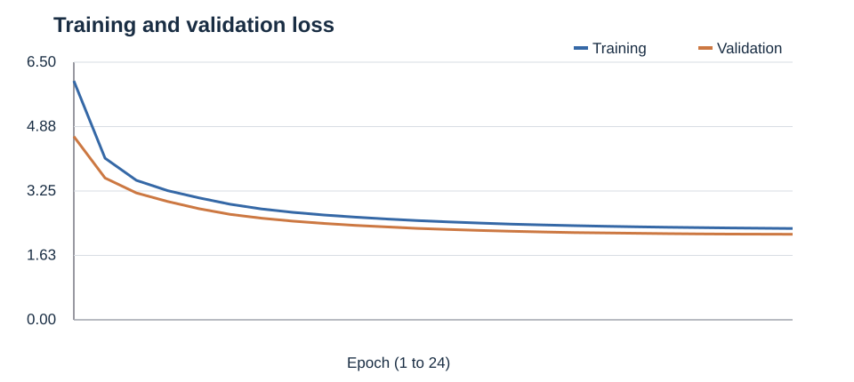
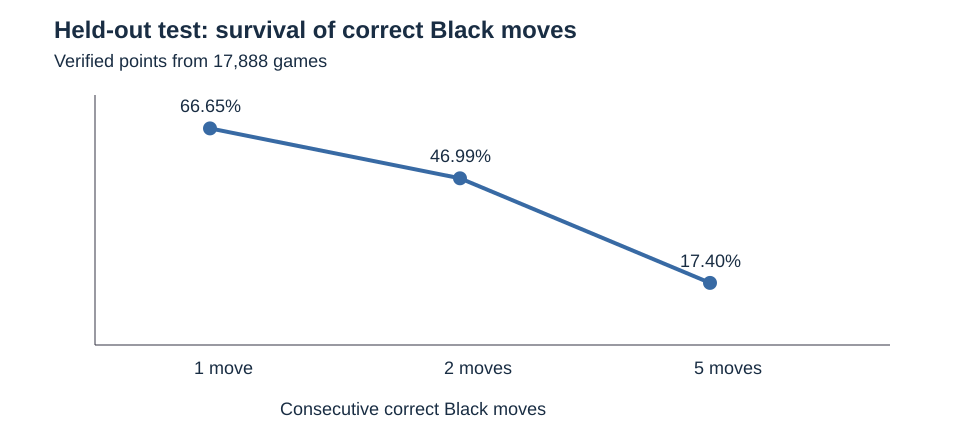
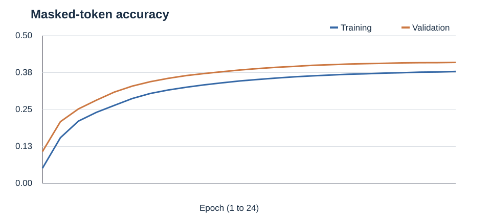

# Chess Move Prediction with an Encoder–Decoder Transformer

Academic deep-learning project by **Sebastiano Giannitti** (University of Bologna). A custom Transformer predicts sequences of **Black chess moves** given the corresponding **White move sequence**, without a board representation, a chess engine, or opening-book data.

> **Scope:** This project predicts the moves recorded in held-out games; it is **not** a chess engine and does **not** guarantee legal moves or optimal chess play. The coursework datasets are not redistributed here.

## Highlights

| Result | Measured value |
|---|---:|
| Held-out test games | **17,888** (0 excluded) |
| Test move accuracy (autoregressive) | **22.72%** |
| Test Survival AUC / mean correct prefix | **2.2590** Black moves |
| Validation Survival AUC (selected configuration) | **2.2511** |
| Final validation masked-token accuracy (teacher forcing) | **40.94%** |
| Trainable model parameters | **4,118,549** |
| Training epochs | **24** |

These results are taken from the saved experiment outputs and independently checked against the supplied `test_predictions.csv` (not distributed). Test accuracy and teacher-forced validation accuracy measure different conditions and should **not** be compared as though they were the same metric.



## Problem and approach

Each game has two whitespace-separated move strings: `white` and `black`. During inference the model is given the White sequence and autoregressively produces Black moves. Input and target tokens use a joint vocabulary fitted only on the training partition. A deterministic, duplicate-aware partition of the 101,364 provided training games produced **91,242 fit** and **10,122 validation** games. The held-out **17,888-game test set** was reserved for the final evaluation.

### Architecture

- Transformer encoder–decoder with **5 encoder** and **5 decoder** blocks.
- Hidden dimension **160**, **5 attention heads**, feed-forward dimension **480**, dropout **0.15**.
- Shared token vocabulary with **6,228** tokens, positional embeddings, causal decoder and cross-attention.
- Weight tying between token embeddings and output projection; gated position-aligned connection between encoder and decoder.
- AdamW, a warm-up + cosine learning-rate schedule, batch size **128** and max sequence length **60**.
- Trained with teacher forcing; decoded autoregressively at inference time. The architecture is under the coursework limit of 6 million trainable parameters.

## Evaluation methodology

The main sequence metric is **Survival AUC**, defined by the survival curve of correct prefix lengths. For each test game, count the consecutive Black moves predicted correctly **before the first incorrect move**. If `S(k)` is the fraction of games with at least `k` consecutive correct Black moves, then

`Survival AUC = Σ S(k) = mean correct-prefix length`.

Unlike ROC-AUC, this metric **is not restricted to the range 0–1**. The final test score is **2.2590** (the average number of consecutive correct moves). Full-test exact move accuracy is **22.718%**.



In the held-out test set, **66.65%** of games begin with at least one correctly predicted Black move; **46.99%** have at least two, and **17.40%** at least five.

### Validation experiments

A data-only positional baseline attained **0.6811 validation Survival AUC** and **11.22%** validation move accuracy. With the trained Transformer, validation decoding was tuned on a deterministic subset: beam search with width **5** and early-score bias **1.0** achieved subset Survival AUC **2.215**, compared with **2.108** for greedy decoding on the same subset. The final selected decoder reached **2.2511** AUC on the complete validation set.

A separate prefix-memory augmentation was tested using only training-derived prefixes. **It did not improve validation results**, so the selected production configuration **disables** memory overrides (support threshold `1e9`, confidence `1.1`). The final test score is thus from the Transformer with the selected beam decoder **without active prefix-memory overrides**.

### Training behavior

All **24** scheduled epochs were completed. Validation loss decreased throughout the run to **2.1581** and teacher-forced masked-token validation accuracy reached **40.94%** at the final epoch. This run does not show an obvious validation-loss increase, but does not prove that more training would necessarily improve autoregressive test performance.



## Repository structure

```text
notebooks/chess_transformer_5x5.ipynb  # Completed experiment, saved outputs
artifacts/                              # Vocabulary, model and inference settings
results/                                # Training log, validation searches, test summary
figures/                                # Plots regenerated from saved metrics
requirements.txt
```

## Running the notebook

1. Obtain the **authorized** course dataset files and place `white_to_black_train.csv` and `white_to_black_test.csv` in the notebook's working directory. The expected columns are `white` and `black`, each containing move sequences separated by spaces.
2. Use a Google Colab GPU runtime. The completed run used TensorFlow **2.21.0** (the provided saved run reports this version); install dependencies if necessary.
3. Execute the notebook sequentially. It uses an optional Google Drive mount for persistence and saves a best checkpoint, training log, vocabulary and configuration.
4. For the published experiment, use the included `artifacts/` and `results/` to inspect the reported parameters and results. **Running the notebook with different data or environment may give different outcomes.**

**Availability limitations:** the original datasets were provided for university coursework and are **not included**. The full test predictions contain those data and are **not distributed**. The `.weights.h5` checkpoint (~48 MiB) and `prefix_memory.pkl` (~26 MiB) are preserved separately by the author; the latter is not needed for the selected inference configuration. The public repository therefore documents an executed experiment but cannot perform identical inference without obtaining the original checkpoint and matching authorized inputs.

## Limitations and possible extensions

- Exact sequence matching is stringent: multiple reasonable Black responses can exist for the same White move sequence.
- No board state or legality constraints are provided to the model; generated move strings are not guaranteed to form a legal game.
- Training vocabulary is limited by the given dataset, and autoregressive errors propagate over longer sequences.
- Future experiments could compare longer training, different beam widths and supervised baselines under identical data splits, with the test set evaluated only once per final model.

## Implementation

**Python · TensorFlow/Keras · NumPy · Pandas · Google Colab · Transformer · beam search.**

This is an educational research prototype, not a production chess-playing system.